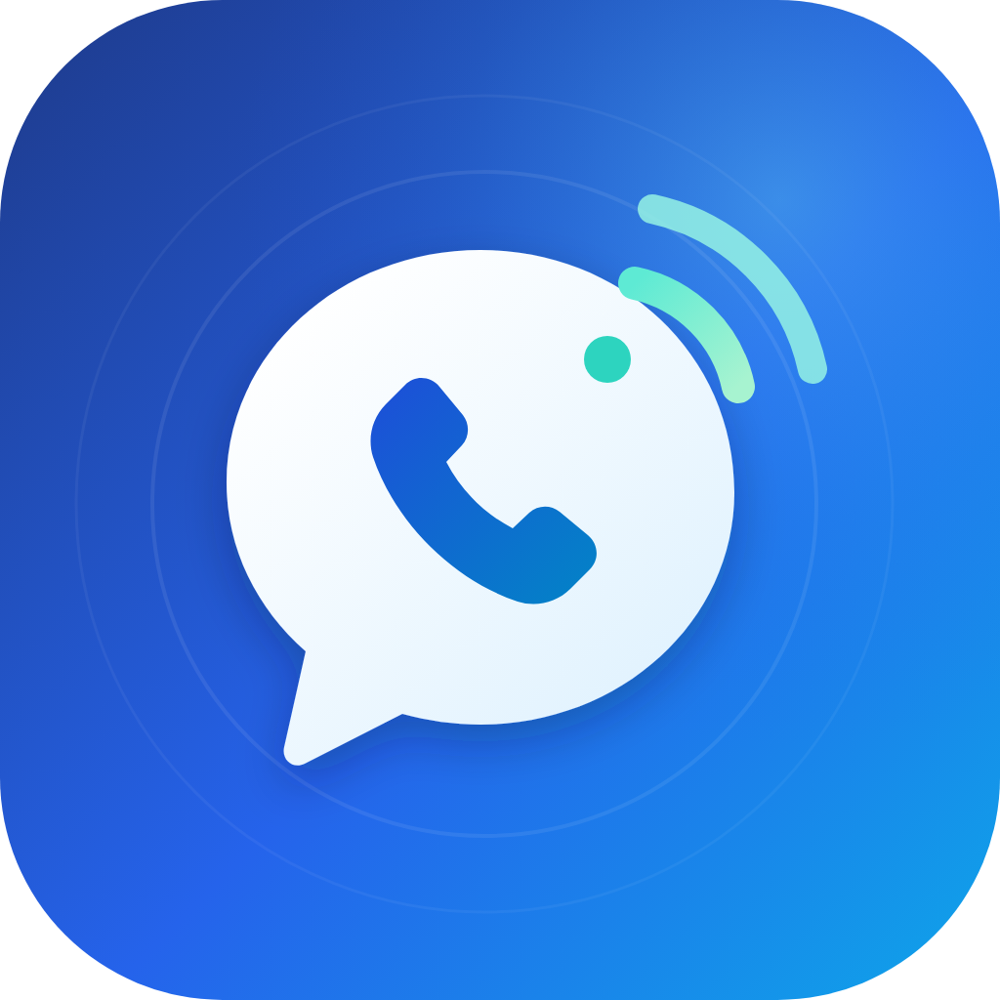
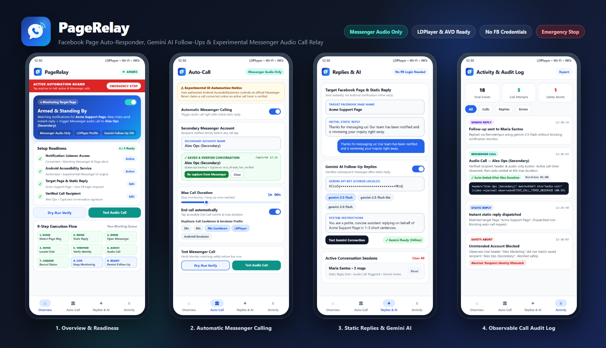
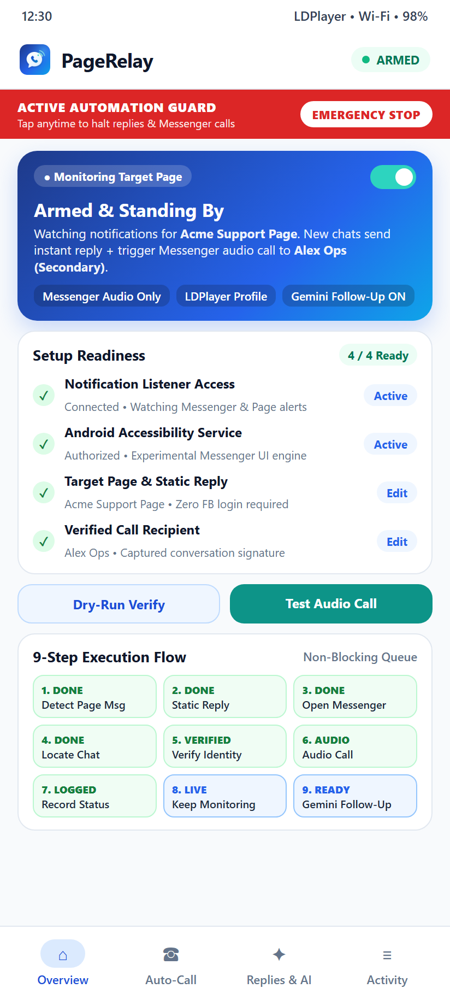
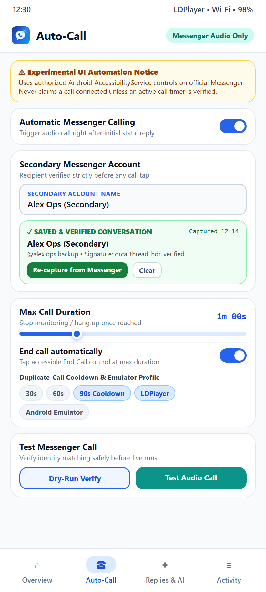
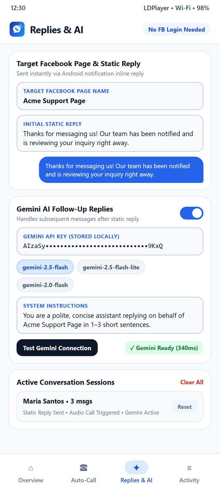
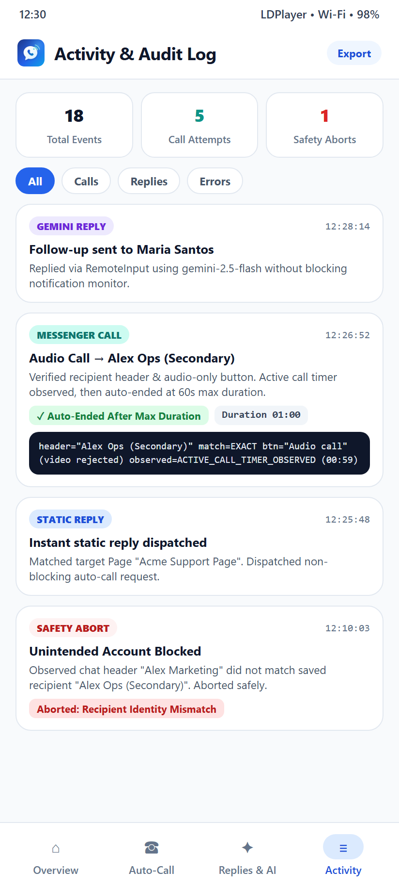
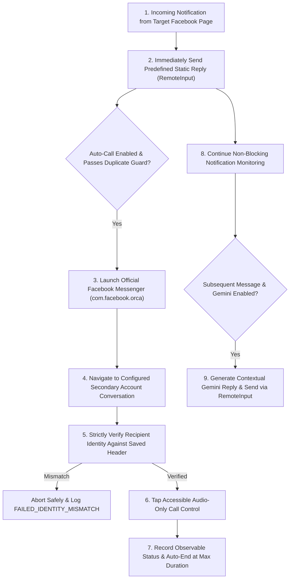

<div align="center">
  
  <h1>PageRelay</h1>
  <p><strong>Automated Facebook Page Responder, Gemini AI Follow-Up Assistant &amp; Experimental Messenger Audio Call Relay for Android</strong></p>

  <p>
    
    
    
    
    
  </p>
</div>

---

<div align="center">
  
</div>

## Overview

**PageRelay** (`com.pagerelay.bot`) is a native Android utility designed for Facebook Page operators who need immediate, reliable alerting when new messages arrive—without storing Facebook credentials or relying on unofficial private APIs.

When a message arrives from your configured Facebook Page:
1. PageRelay detects the incoming notification via Android's `NotificationListenerService`.
2. It immediately submits your predefined **static reply** via Android's standard notification inline reply (`RemoteInput`).
3. Without blocking incoming message monitoring, it launches official Facebook Messenger (`com.facebook.orca`), navigates to your configured secondary Messenger account, **strictly verifies the recipient's identity**, and initiates a **Messenger audio call** via an explicitly user-authorized Android `AccessibilityService`.
4. Every call attempt, observable UI status, duration, and error is logged to a local Room SQLite audit database.
5. For subsequent incoming messages in that conversation, **Gemini AI** can optionally generate concise, context-aware follow-up replies.

> **Experimental UI Automation Notice**  
> Facebook Messenger personal-account calling has **no official automation API**. Automatic Messenger calling in PageRelay is implemented strictly as **experimental Android AccessibilityService UI automation** and must be verified through controlled testing in your target environment (LDPlayer or Android Studio Emulator). PageRelay **never claims a call connected** unless an active call timer (`MM:SS`) and active call controls are explicitly observed in the Messenger UI.

---

## Screenshots

| Overview & Setup Readiness | Automatic Messenger Calling | Static Replies & Gemini AI | Observable Call Audit Log |
| :---: | :---: | :---: | :---: |
|  |  |  |  |

---

## Execution Flow



---

## Automatic Messenger Calling Features

### User Configuration (`Auto-Call` Tab)
- **Enable / Disable Automatic Messenger Calling** with a single master toggle.
- **Configure Secondary Messenger Account Name** used to locate and verify the recipient conversation.
- **Capture & Save Recipient Conversation**: Open your secondary account chat in Messenger once and capture its verified display name, handle/subtitle, and accessibility header signature.
- **Test Messenger Call Functionality**:
  - **Dry-Run Verification**: Launches Messenger, locates the chat, verifies recipient identity, and locates the audio-only call button *without* placing a call.
  - **Test Live Audio Call**: Executes the full audio-only call sequence using your configured duration and auto-end rules.
- **Maximum Call Duration**: Configurable slider (`15s` – `300s`).
- **Auto-End After Max Duration**: Toggle to automatically locate and tap the accessible End Call button once the maximum call duration is reached.
- **Emulator Timing Profiles**: Tuned presets for **LDPlayer**, **Android Studio Emulator**, and **Physical Android Devices**.

### Safety, Reliability & Observable Status Guarantees
- **Explicit User Authorization**: Requires standard Android Notification Access and Accessibility Service opt-in with live readiness indicators.
- **Accessible UI Identifiers First**: `MessengerNodeFinder` resolves controls by `viewIdResourceName`, `contentDescription`, `text`, and `className` rather than brittle screen coordinates, and explicitly rejects Video Call, SMS, or dialer buttons.
- **Prevents Calling Unintended Accounts**: `RecipientIdentityVerifier` normalizes headers, strips Messenger status suffixes (e.g., `"Active now"`), checks saved secondary labels, and immediately aborts with `FAILED_IDENTITY_MISMATCH` on any ambiguity or mismatch.
- **Duplicate Call Prevention**: `CallGuard` enforces an atomic active-call lock plus a configurable cooldown window (`30s`–`300s`).
- **Non-Blocking Architecture**: Calling runs on an isolated coroutine worker fed by a buffered channel so incoming notifications are never delayed or dropped.
- **Emergency Stop Control**: Always accessible via the persistent crimson **EMERGENCY STOP** bar inside the app AND a one-tap **EMERGENCY STOP** button on the active status notification. Immediately halts active call automation, attempts to end an active call, and disarms automation until explicitly re-armed.
- **Honest Observable Status Logging**: Every call attempt logs verifiable states:
  - `CALL_INITIATED_UNVERIFIED` — Audio call control was clicked; call state not yet confirmed.
  - `RINGING_OBSERVED` — Messenger calling/ringing UI or End Call control observed.
  - `ACTIVE_CALL_TIMER_OBSERVED` — Active call timer (`MM:SS`) and active call controls observed.
  - `ENDED_AUTOMATICALLY` / `COMPLETED_HANDOFF` / `DRY_RUN_VERIFIED`
  - `FAILED_IDENTITY_MISMATCH` / `FAILED_UI_NOT_FOUND` / `FAILED_TIMEOUT` / `EMERGENCY_STOPPED`

---

## Strict Restrictions & Scope

PageRelay enforces the following boundaries in both manifest permissions and runtime logic:
- **Messenger audio calls only** (video call controls are explicitly excluded).
- **No cellular calls** (`CALL_PHONE` is not declared).
- **No SMS** (`SEND_SMS` / `READ_SMS` are not declared).
- **No WhatsApp or Telegram integration**.
- **No external calling APIs**.
- **No unofficial Messenger private APIs**.
- **No Facebook credentials stored or requested** inside the application.
- **No authentication or security bypasses**.

---

## Setup Guide (LDPlayer & Android Studio Emulator)

### 1. Build & Install
Requires **JDK 17** and **Android SDK 36**.

```bash
# Run all JVM unit tests
./gradlew testDebugUnitTest

# Build debug APK
./gradlew assembleDebug
```

Install the generated APK (`app/build/outputs/apk/debug/app-debug.apk`) onto LDPlayer or Android Studio Emulator:
```bash
adb install -r app/build/outputs/apk/debug/app-debug.apk
```

### 2. Grant Explicit Android Permissions
1. Open **PageRelay** and check the **Setup Readiness** card on the **Overview** tab.
2. Tap **Notification Listener Access** and enable **PageRelay Message Monitor**.
3. Tap **Android Accessibility Service** and explicitly authorize **PageRelay Messenger Call Automation**.
4. Ensure official **Facebook Messenger** (`com.facebook.orca`) is installed and signed in on your emulator/device.

### 3. Configure Page, Recipient & Verify
1. In **Replies & AI**, enter your **Target Facebook Page Name** and your **Initial Static Reply** (and optionally enable **Gemini AI** with your own Gemini API key).
2. In **Auto-Call**, select your emulator profile (**LDPlayer** or **Android Studio Emulator**), enter the **Secondary Messenger Account Name**, and tap **Capture from Messenger** while viewing that conversation to save its verified signature.
3. Run **Dry-Run Verify** first to confirm recipient matching and audio-call button detection on your Messenger version, then test with **Test Audio Call**.
4. Return to **Overview** and toggle **Armed** to begin live monitoring.

---

## Project Architecture

```text
app/src/main/java/com/pagerelay/bot/
├── PageRelayApplication.kt              # Dependency container wiring
├── MainActivity.kt                      # Edge-to-edge Material 3 host & 4-tab navigation
├── domain/
│   ├── Models.kt                        # AppSettings, CallObservableStatus, AuditLogEntry, ExecutionFlowSpec
│   └── AppContracts.kt                  # SettingsStore, AuditLogStore, AutomationController interfaces
├── data/
│   ├── SettingsRepository.kt            # Jetpack DataStore Preferences persistence
│   ├── AuditDatabase.kt                 # Room SQLite database & DAO
│   └── AuditLogRepository.kt            # Bounded audit log repository
├── ai/
│   └── GeminiReplyClient.kt             # Gemini REST client for follow-up replies
├── automation/
│   ├── AutomationCoordinator.kt         # Non-blocking reply + call orchestration state machine
│   ├── CallGuard.kt                     # Atomic active-call lock & duplicate cooldown guard
│   ├── RecipientIdentityVerifier.kt     # Strict normalized recipient identity verification
│   ├── MessengerNodeFinder.kt           # Resilient accessible UI node finder & observable call detector
│   ├── ConversationSessionManager.kt    # Per-conversation static vs Gemini follow-up session tracking
│   ├── AccessibilityServiceBridge.kt    # Decoupled bridge between coordinator and AccessibilityService
│   └── EmergencyStopNotificationHelper.kt # One-tap Emergency Stop notification control
├── service/
│   ├── PageNotificationListenerService.kt # Watches Messenger/Page notifications & sends inline replies
│   ├── MessengerCallAccessibilityService.kt # Authorized AccessibilityService UI driver
│   └── EmergencyStopReceiver.kt         # Instant Emergency Stop broadcast handler
└── ui/
    ├── MainViewModel.kt                 # Reactive StateFlow UI state & user actions
    ├── SystemSettingsNavigator.kt       # Android settings & Messenger launch helpers
    ├── theme/                           # Material 3 Color, Typography & Theme
    ├── components/                      # EmergencyStopBar, PipelineStepperCard, CommonComponents
    └── screens/                         # DashboardScreen, AutoCallScreen, RepliesAiScreen, ActivityLogsScreen
```

---

## Unit Tests

JVM tests in `app/src/test/java/com/pagerelay/bot/` verify critical safety invariants without requiring a physical device:
- `RecipientIdentityVerifierTest` — exact match, Unicode/whitespace normalization, status suffix stripping, secondary label verification, and strict rejection of mismatched/blank headers.
- `MessengerNodeFinderTest` — audio-only call button detection, strict rejection of video/SMS/cellular buttons, end-call detection, and strict differentiation between `ACTIVE_CALL_TIMER_OBSERVED`, `RINGING_OBSERVED`, and `UNKNOWN`.
- `CallGuardTest` — active-call concurrency lock, duplicate cooldown enforcement, and emergency reset.
- `ConversationSessionManagerTest` — first-message static reply + auto-call routing, duplicate message suppression, subsequent Gemini follow-up routing, and session resets.

---

## License

MIT License — built as a hobby/experimental Android automation project. Use responsibly and in compliance with platform terms and local laws.
